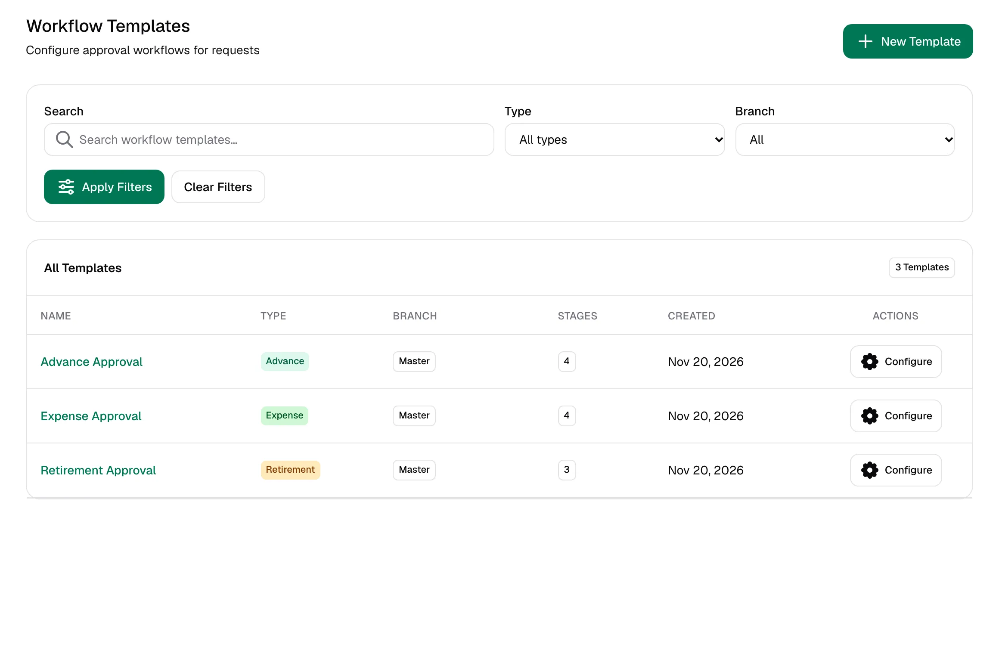
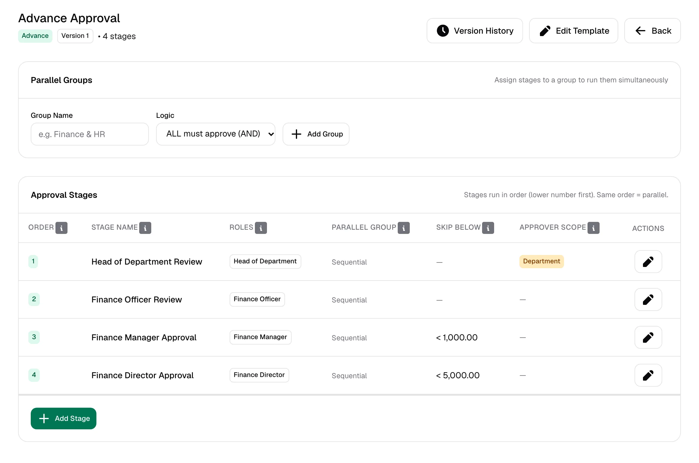
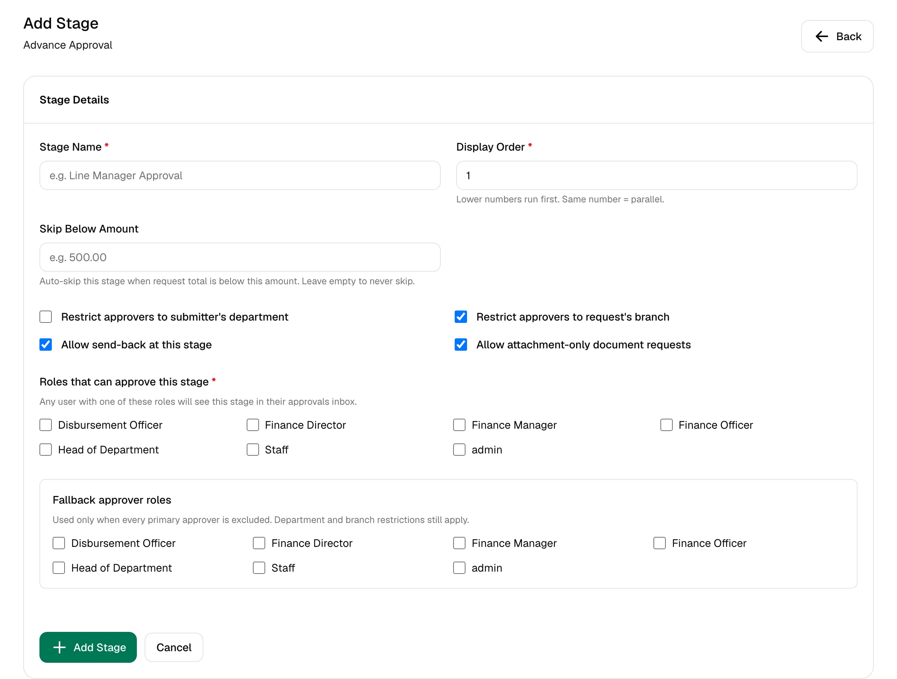
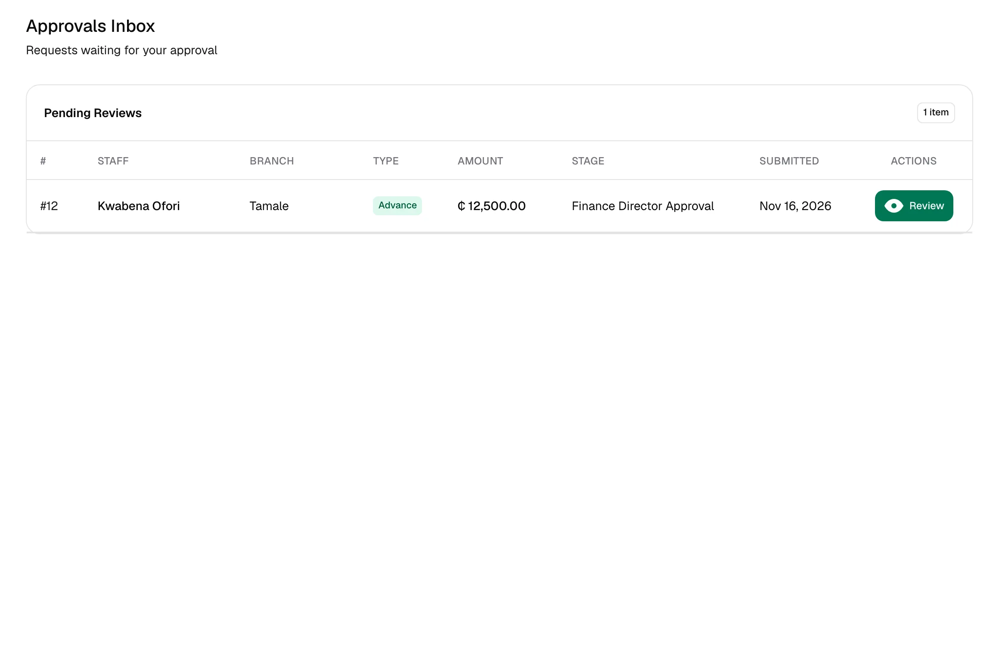
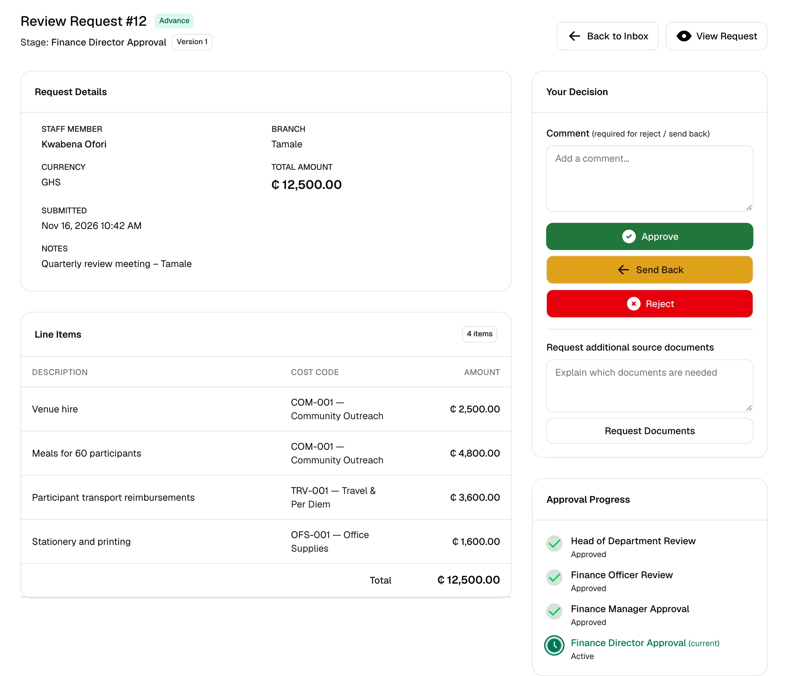

## How approval workflows work {#how-approvals-work}

Every [Payment Request](/docs/payment-requests/) and [Retirement Request](/docs/retirement-requests/) is routed through a **Workflow Template** — a named, reusable approval chain made up of ordered **Stages**. When someone submits a request, Flow Ledger picks the template configured for that request type and branch (or falls back to the organization-wide "Master" template for that type), and activates its first stage.

Templates and their stages are configured by administrators under **Settings → Workflows**; the day-to-day reviewing happens in **Approvals**.

## Configuring workflow templates {#configuring-workflow-templates}

Go to **Settings → Workflows** and click **New Template**. Give it a **Template Name**, pick a **Type** — Advance, Expense, or Retirement — and optionally a **Branch**. Leave the branch blank to make this the default ("Master") workflow used whenever a specific branch doesn't have its own template for that type.

> Every request type needs at least one Master template somewhere, or submissions for that type will fail with a message asking users to contact an administrator.

When a request is actively moving through a template, it stays attached to that exact workflow version. Structural edits create a new draft version instead of changing the version used by in-flight requests. Review and publish the draft when it is ready; publication affects new requests, while existing requests continue safely on their original version.

## Configuring stages and parallel groups {#configuring-stages}

Open a template and add **Approval Stages**. Each stage needs:

- **Stage Name**.
- **Display Order** — lower numbers run first; stages sharing the same order run at the same time.
- **Skip Below Amount** — optional; the stage is skipped automatically when the request total is below this figure.
- **Roles that can approve this stage** — the primary approver roles. Eligible users holding one of these roles see the stage in their Approvals inbox. There's no way to assign a specific person, position, or department head directly — approver assignment is always role-based.
- **Fallback approver roles** — optional roles used only when no independent user remains eligible through the primary roles. A role can't be both primary and fallback on the same stage.
- **Restrict approvers to submitter's department** and **Restrict approvers to request's branch** — narrow the pool of eligible approvers further (branch restriction is on by default).
- **Allow send-back at this stage** — when unticked, approvers at this stage can only approve or reject.
- **Allow attachment-only document requests** — lets approvers at this stage ask the requester for more documents without sending the request back (see [Asking for more documents](#requesting-documents)).
- **Parallel Group** — optional; see below.

Use **Parallel Groups** when several stages should run together rather than one after another. Each group has a name and a **Logic**:

- **ALL must approve** — the group only clears once every stage in it is approved.
- **ANY one approves** — the group clears as soon as one stage in it is approved, and the rest are automatically cancelled.

> Plan for a different person at every required approval stage. This is especially important for sequential workflows and parallel groups where **ALL must approve**. Fallback roles are a safety net, but they still need an eligible user who hasn't submitted or already acted on the request.

## Keeping approvals independent {#independent-approvals}

Flow Ledger separates requesting, approving, and paying out so that one person can't control several steps of the same request. It applies these rules automatically:

- **The requester can't approve their own request.** If the requester holds an approver role, the stage isn't skipped; Flow Ledger looks for another eligible person.
- **One person can act at only one stage in the same workflow.** After you Approve, Send Back, or Reject at one stage, you can't act at another stage for that request. If a sent-back request returns to your original stage, you can continue handling that same stage.
- **Department and branch restrictions still apply.** For a restricted stage, both the request and approver need matching staff assignments. Missing department or branch information doesn't bypass the restriction.
- **Primary roles are checked first.** Fallback roles are used only when no primary-role user is eligible.

Your **Approvals** inbox, pending-review counts, and notifications include only stages where you're currently eligible. This means a stage may disappear from your inbox after you act elsewhere in the same workflow, even if you hold the role assigned to it.

### When a stage is blocked

If neither the primary nor fallback roles contain an independent eligible approver, the stage appears as **Blocked** in **Approval Progress** with the message *"No independent approver is currently available for this stage."* It isn't skipped or approved automatically, and later stages wait.

This works the same way for Payment Request and Retirement Request approval stages. Start by assigning a different user to one of the stage's existing primary or fallback roles under [**Settings → Users**](/docs/roles-permissions/#creating-roles). For a restricted stage, also confirm the user's department and branch under [**Organisation → Staff**](/docs/branches/#staff). A user with permission to edit workflow templates can then open the request and click **Retry approver resolution**:

- If an eligible user is now available, the stage becomes **Active** and the approvers are notified.
- If nobody qualifies yet, the stage remains blocked and Flow Ledger shows *"The stage is still blocked because no independent approver is available."*

### When the original workflow has no fallback role

If the request is attached to an older workflow version that has no suitable fallback role, choose **Add one-request fallback**. Select a role that has an independent eligible user, enter the reason for the exception, and choose **Apply fallback and retry**.

> A one-request fallback changes only the blocked request. It does not change the main workflow template or move the request to a newer workflow version.

After the request is recovered, Flow Ledger keeps a **Main workflow update required** notice in Approval Progress. Choose **Update main workflow** to add the same fallback role to a workflow draft. The notice changes to **Workflow draft update pending publication**; open the draft, review it, and choose **Publish**. Once published, the request records that the main workflow has been updated for future Payment Requests and Retirement Requests.

If you can't edit workflow templates, the notice asks you to contact a workflow administrator. Recovering the current request and updating the main workflow are recorded separately in the activity history.

## Approving a request {#approving-a-request}

Open **Approvals** to see your **Pending Reviews** — every request currently waiting on a stage you're eligible to act on. Click **Review** to open a request's **Request Details**, its **Line Items**, the **Action History** so far, and the **Approval Progress** stepper showing every stage in the workflow.

Holding an approver role doesn't guarantee that every stage using that role will appear here. Flow Ledger also checks that you didn't submit the request or act at another stage, plus any department and branch restrictions configured for the stage.

In the **Your Decision** panel, add a **Comment** (required for Reject or Send Back, optional for Approve) and choose:

- **Approve** — clears this stage and moves the request on.
- **Send Back** — returns the request to the submitter for revision.
- **Reject** — cancels the entire workflow. You'll be asked to confirm: *"Reject this request? This will cancel the entire workflow."*

## Asking for more documents {#requesting-documents}

When a request is fine except for missing paperwork, you can ask for the documents instead of sending the whole request back. This needs **Allow attachment-only document requests** on the stage.

1. On the review page, under **Request additional source documents**, explain which documents you need and click **Request Documents**.
2. Your stage is put on hold: the decision panel shows *"Approval actions are temporarily frozen"* with your reason. A workflow can have only one open document request at a time.
3. The requester sees **Additional documents requested** with your reason on their request. They click **Upload a requested document** (PDF, JPG, PNG, Word or Excel, up to 10 MB each), can remove a wrong file, and click **Submit documents**. Their uploads then close.
4. Back on your review page, click **Resume my review**, then approve, send back or reject as usual.

If the new documents could change something an earlier approver signed off, you can ask them to look again before you resume. Tick their names under **Optional advisory re-review** and click **Request advisory review**. Each of them finds it under **Advisory document reviews** in their Approvals inbox, chooses **Confirmed** or **Concern** (a concern needs a comment), and clicks **Submit review**. Once everyone has responded, click **Resolve hold**. If anyone raised a concern, you must choose how to resolve it, with a reason: ask for another round of documents, send the request back, reject it, or override the concern and resume.

A user who can edit workflow templates can close a document request that has been left unanswered with **Cancel abandoned window**, giving a reason.

## Send Back vs. Reject {#send-back-vs-reject}

These look similar but behave very differently, and it's worth being deliberate about which one you use:

- **Send Back** is recoverable — the request returns to **Sent Back** status, the submitter can edit it, and resubmitting sends it straight back to the stage that returned it (not to the start of the workflow).
- **Reject** is terminal — the request becomes **Denied**, every remaining stage is cancelled, and there is no way to bring it back. If the request should still go through in some form, use Send Back instead so the submitter isn't forced to start over. A rejected **retirement** is marked **Cancelled** instead, because the advance still has to be accounted for: the staff member can file a new retirement for it.

Next, see how approved requests get paid out and disbursed cash is tracked in [Cash Management](/docs/cash-management/).
