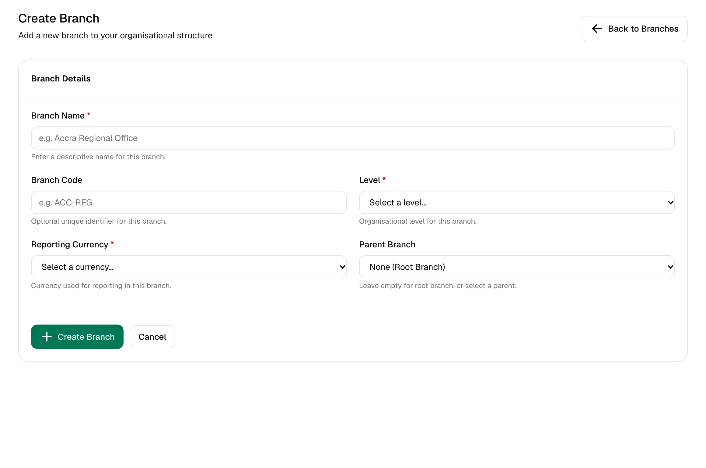
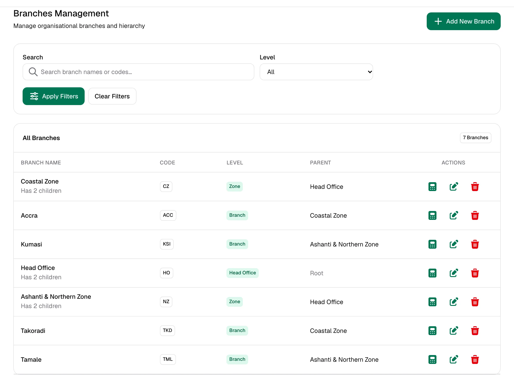
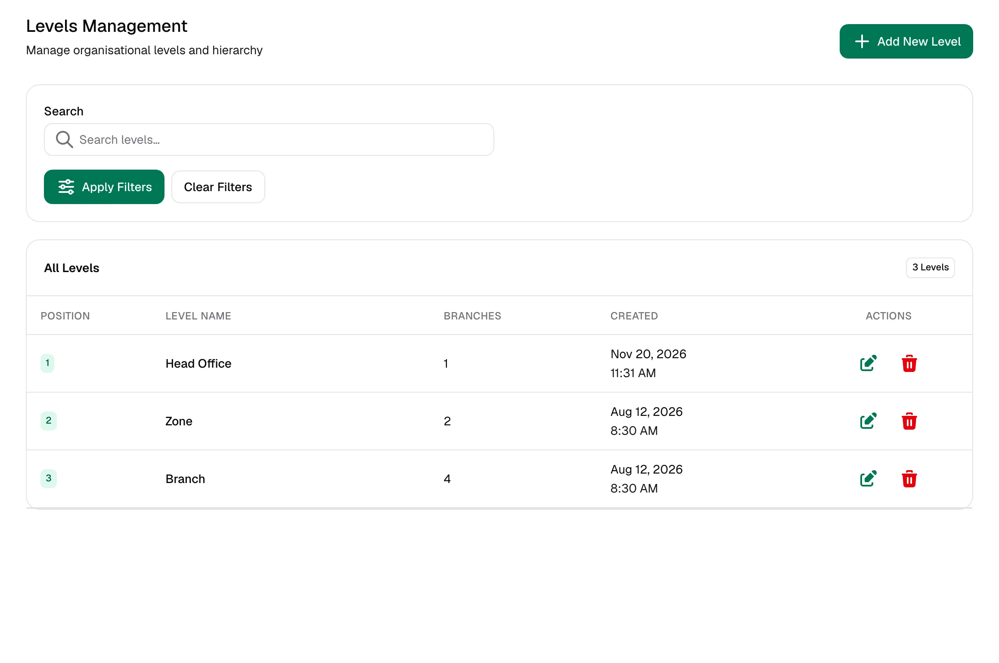
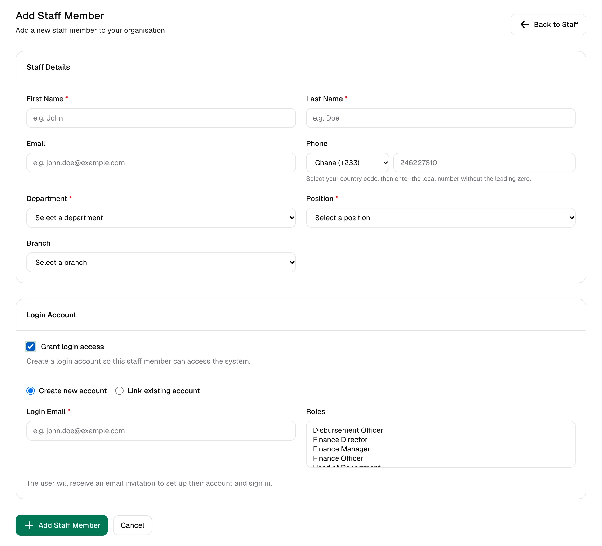

## Branches {#branches}

Under **Organisation → Branches**, your organization's locations form a tree — every branch can have a **Parent Branch**, and leaving that blank makes it a root branch. A new organization starts with one root branch, **Head Office**.

Each branch has a **Branch Name**, an optional unique **Branch Code**, a **Position** (its display order among siblings), a **Level** (see below), and a **Reporting Currency**. Moving a branch to a new parent automatically updates every report and hierarchy view that depends on it.

A branch can't be deleted while it still has staff assigned to it or child branches beneath it — move or remove those first.

## Levels {#levels}

Under **Organisation → Levels**, a **Level** is a separate, flat classification every branch belongs to — for example "Head Office", "Regional Office", "Branch" — each with a **Level Name** and a **Position** (lower numbers sit higher in the hierarchy).

> A Level is not the same thing as depth in the branch tree — it's a label you assign, independent of a branch's actual parent/child position. Levels are for organizing and reporting, not for routing approvals: they play no part in who approves a request. That's controlled entirely by roles — see [Configuring stages and parallel groups](/docs/approval-workflows/#configuring-stages).

A Level can't be deleted while any branch is still assigned to it.

## Departments and positions {#departments-and-positions}

Under **Organisation → Departments** and **Organisation → Positions**, both are simple named lists used to classify staff — for example a Department of "Finance" and a Position of "Accountant". A Position can't be deleted while staff still hold it.

Both support bulk creation via a CSV upload with a single **name** column — handy when you're setting up a new organization with a long list already on hand.

## Staff and login access {#staff}

Under **Organisation → Staff**, click **Add Staff Member** and fill in their **First Name**, **Last Name**, **Email**, **Phone**, required **Department** and **Position**, and optional **Branch**.

A staff record on its own doesn't grant anyone the ability to log in — that's a separate step. Check **Grant login access** to reveal two choices:

- **Create new account** — set up a brand-new login with an email, password, and roles.
- **Link existing account** — attach the staff record to a user who already has a login but no staff profile yet.

A user account can only ever be linked to one staff record.

For bulk setup, use the **Staff** import — an XLSX template with columns for name, contact details, department, position, branch, and whether to grant login access. Unlike the Departments/Positions import, this one is row-by-row: any row with a problem is skipped and reported individually, so the rest of the file still goes through. Granting login access during import creates the account with a random password and no roles assigned yet — assign roles afterward.

Next, set up who can approve what in [Roles & Permissions](/docs/roles-permissions/), or jump straight to [Payment Requests](/docs/payment-requests/) if your organization's structure is already in place.
