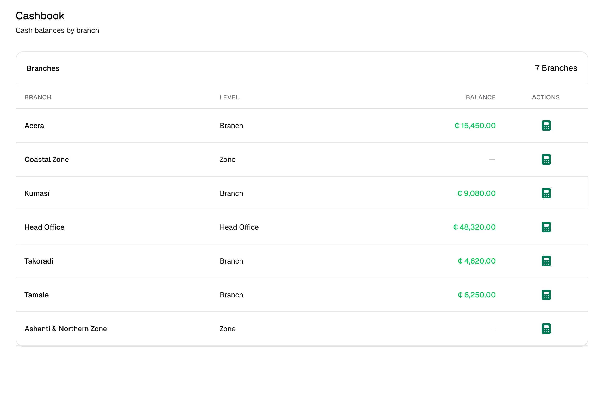
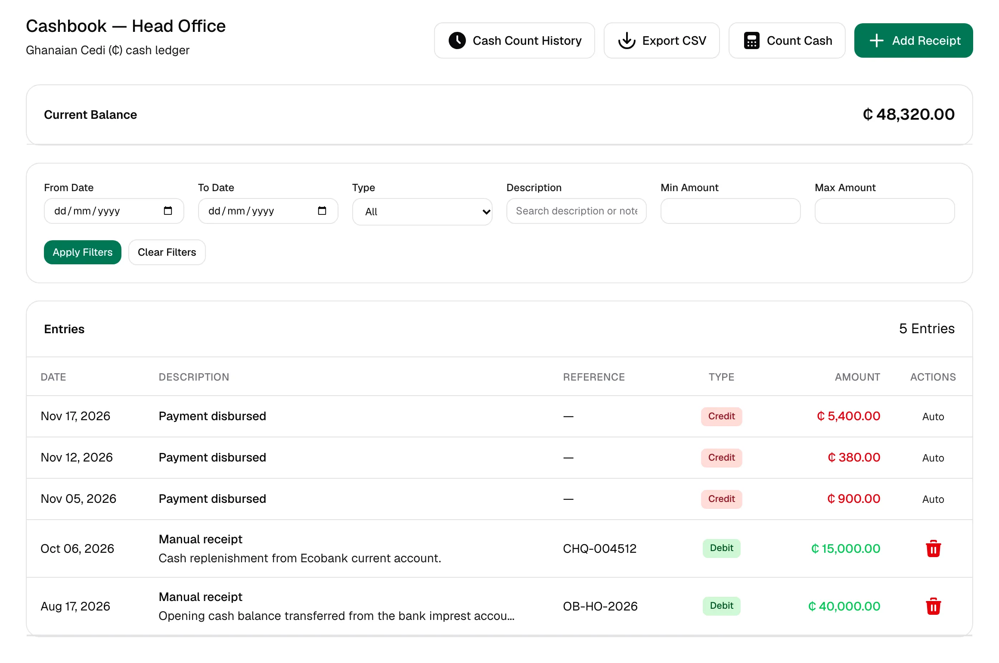
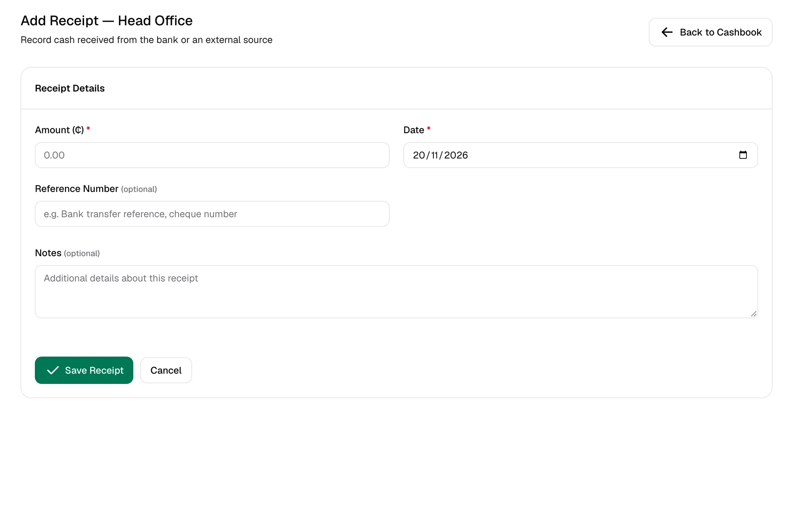
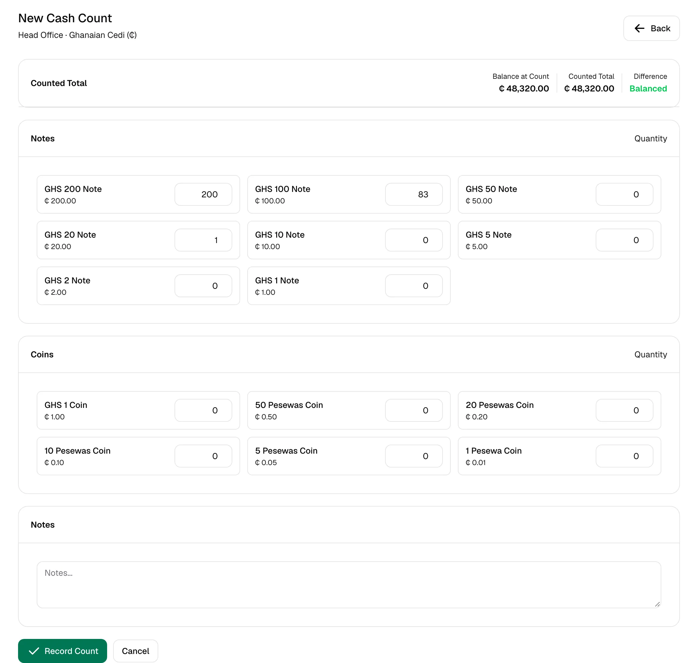
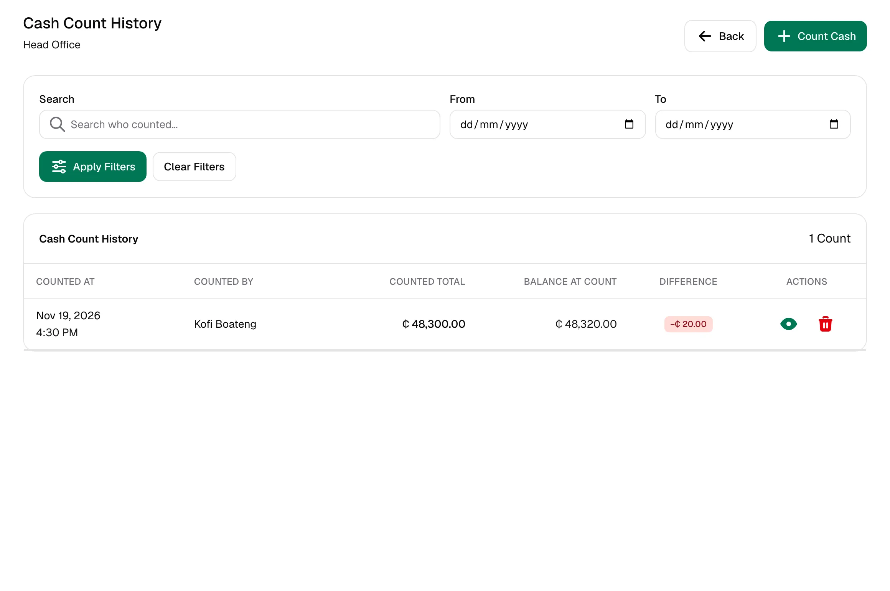
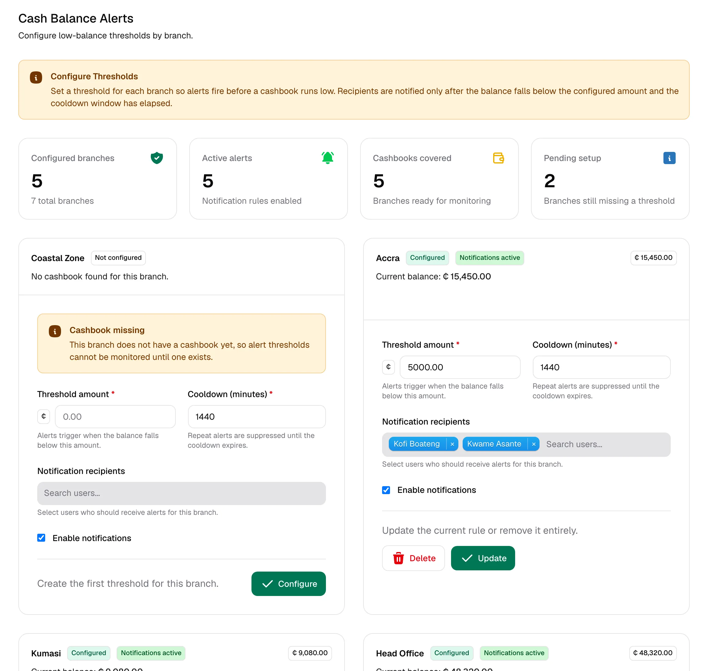

## Cashbook {#cashbook}

Every branch has its own **Cashbook** — a running balance in that branch's currency, with a chronological list of **Entries**. Open **Finance → Cashbook** to see balances across all your branches, then open a branch to see its full ledger.

Most entries are created automatically:

- A **Debit** (balance increases) — for example a manual receipt, or a refund from a staff member settling a retirement.
- A **Credit** (balance decreases) — for example disbursing a payment request, or paying out the difference on a settled retirement.

Auto-generated entries are marked **Auto** and can't be deleted — their history lives permanently on the Cashbook and on the request that created them. Use the **From Date**, **To Date**, **Type**, **Description**, and amount filters to narrow the list, and **Export CSV** to download it.

> Cash can only be paid out of what the branch holds. A disbursement, or a retirement settlement that pays extra to a staff member, is blocked with *"Insufficient cashbook balance..."* unless the balance covers the full amount. That includes a branch whose cashbook is at zero, such as a branch that has never recorded a receipt, so record the branch's opening cash as a [manual receipt](#manual-receipts) before its first payout. A refund from a staff member is never blocked.

## Recording a manual receipt {#manual-receipts}

When cash comes in from the bank or another external source, open the branch's Cashbook and click **Add Receipt**. Enter the **Amount**, **Date**, and an optional **Reference Number** and **Notes**, then **Save Receipt**. This is the only kind of entry you create directly — and the only kind you can delete, if it was entered in error.

## Cash Count {#cash-count}

A Cash Count reconciles the physical cash in a branch against what the Cashbook says the balance should be. It's diagnostic only — performing a count never changes the Cashbook balance itself.

From a branch's Cashbook, click **Count Cash**. Enter the quantity of each **Note** and **Coin** denomination configured for that branch's currency (see [Denominations](/docs/cost-codes-currencies/#denominations)) — Flow Ledger totals them live and compares against the current Cashbook balance, showing:

- **Balanced** — the counted total matches the balance.
- **Surplus** — you counted more than the recorded balance.
- **Deficit** — you counted less than the recorded balance.

Add optional **Notes** and click **Record Count**. **Count History** keeps every past count, each one preserving the denomination values used at the time — so history stays accurate even if denomination values change later. If no denominations are configured yet for the branch's currency, you'll be asked to add them first.

## Cash Balance Alerts {#cash-balance-alerts}

Under **Settings → Cash Balance Alerts**, configure a low-balance threshold per branch: a **Threshold amount**, a **Cooldown (minutes)** to avoid repeat notifications for the same dip, and the **Notification recipients** who should be emailed and notified in-app. Toggle **Enable notifications** to turn alerting on or off without deleting the configuration.

Whenever a branch's balance changes and drops below its threshold (and the cooldown has elapsed), configured recipients get a **"⚠️ Low Cash Balance Alert"** notification. Branches below their threshold also show up on the [dashboard](/docs/getting-started/#dashboard) for anyone with Settings access.

Next, see how cost codes and currencies feed into requests and cash counts in [Cost Codes & Currencies](/docs/cost-codes-currencies/).
