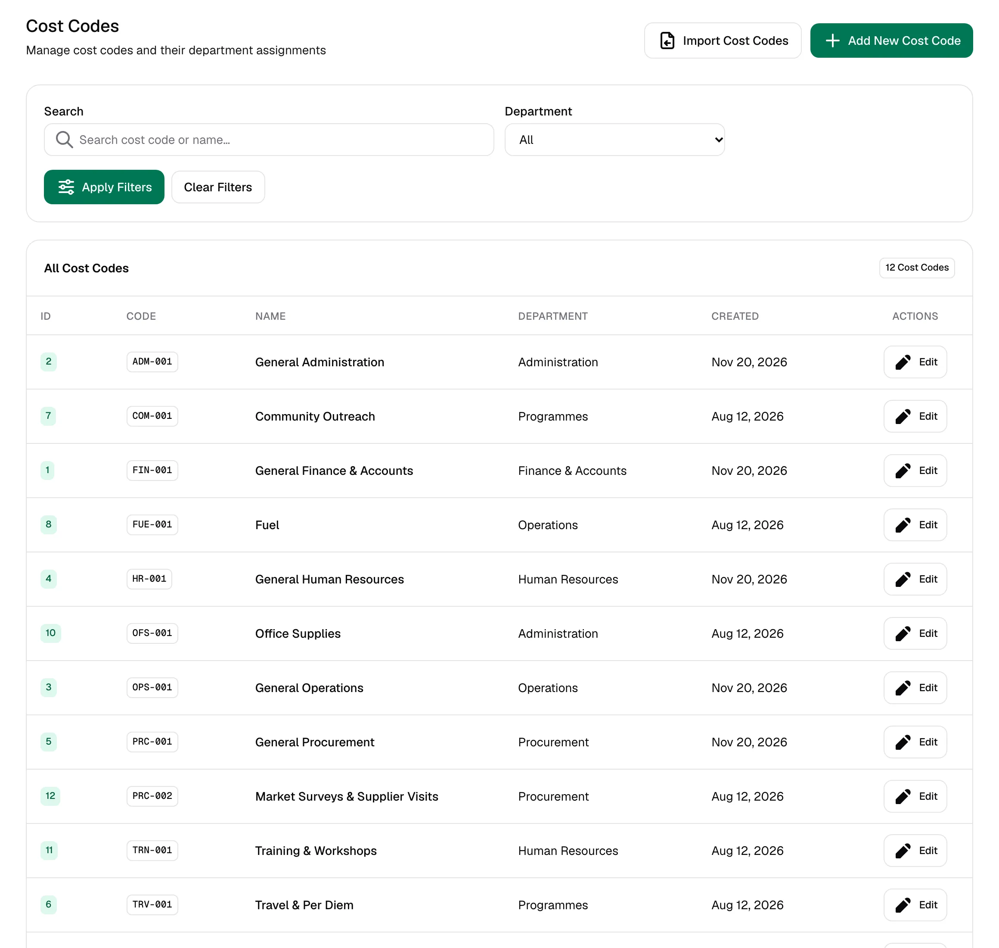
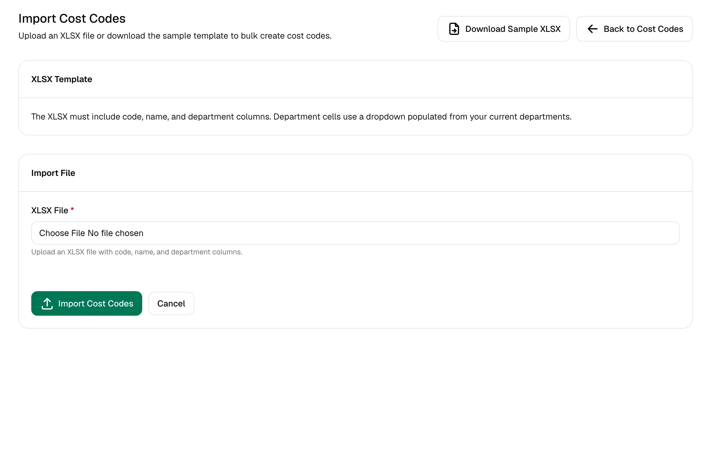
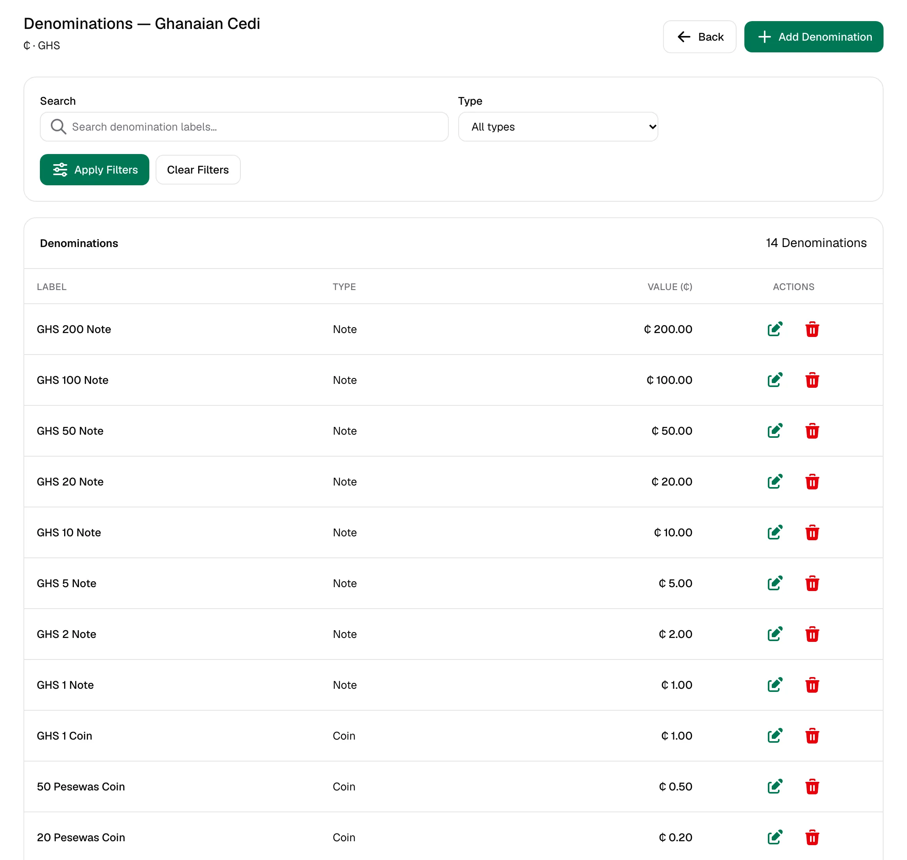

## Cost codes {#cost-codes}

A **Cost Code** classifies what money is being spent on — a simple **Code** (e.g. `CC-1001`) and **Name** (e.g. "Office Supplies"), each assigned to a **Department**. Under **Organisation → Cost Codes**, click **Add New Cost Code** to create one.

Cost codes are required on every **Expense** line item in a [Payment Request](/docs/payment-requests/), and on every item in a [Retirement Request](/docs/retirement-requests/). For **Advance** line items, a cost code is optional — Flow Ledger falls back to a default advance cost code configured in [Settings](/docs/settings/#request-defaults) if you leave it blank.

## Importing cost codes {#importing-cost-codes}

To set up many cost codes at once, click **Import Cost Codes** and download the sample template first — an XLSX file with **code**, **name**, and **department** columns (in that exact order), with the Department column offering a dropdown of valid departments. Upload your completed file with **Import Cost Codes**.

The import is all-or-nothing: every row is validated before anything is saved, and you'll get a full list of row-by-row problems (missing values, codes over 50 characters, names over 150 characters, duplicate codes, or codes that already exist) if anything's wrong — fix the file and try again.

## Currencies {#currencies}

Under **Settings → Currencies**, each currency has a **Currency Name** (e.g. "Ghana Cedi"), a **Currency Code** (e.g. "GHS"), and a **Currency Symbol** (e.g. "₵"). Every branch is fixed to one currency, and requests are created in a chosen currency too.

> Flow Ledger does not convert between currencies — there's no exchange rate table or consolidated reporting currency. A branch, its Cashbook, and the requests raised against it all simply use whichever currency they were set up with.

## Denominations {#denominations}

Each currency has its own set of physical **Denominations** — the individual notes and coins used when performing a [Cash Count](/docs/cash-management/#cash-count). Open a currency and click **Add Denomination** to add a **Label**, a **Value**, and a **Type** (Note or Coin).

A denomination can't be deleted once it's been used in a cash count — its value is preserved in that count's history permanently.

Next, see who's allowed to do what in [Roles & Permissions](/docs/roles-permissions/).
