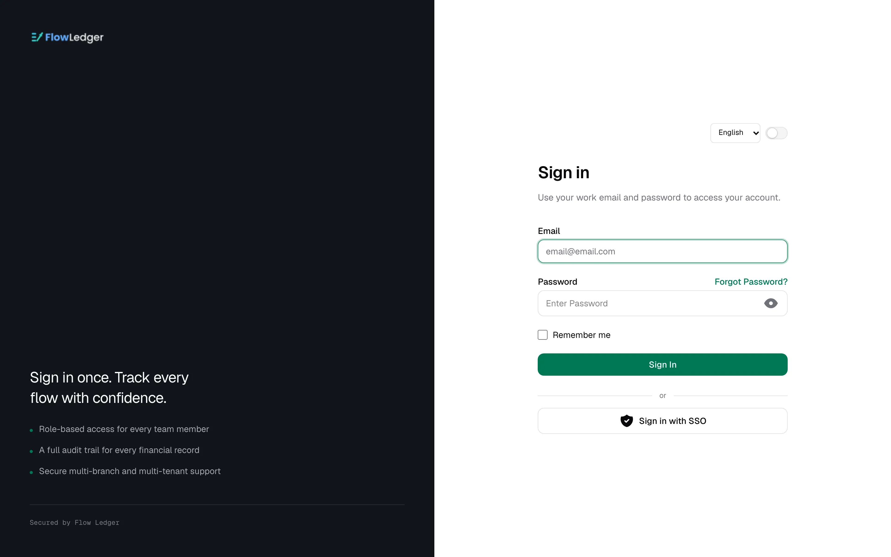
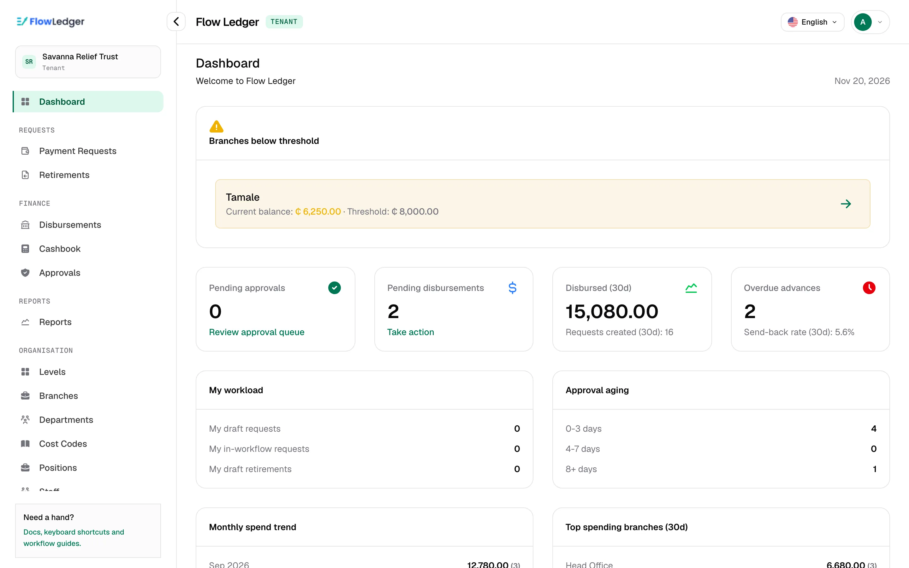
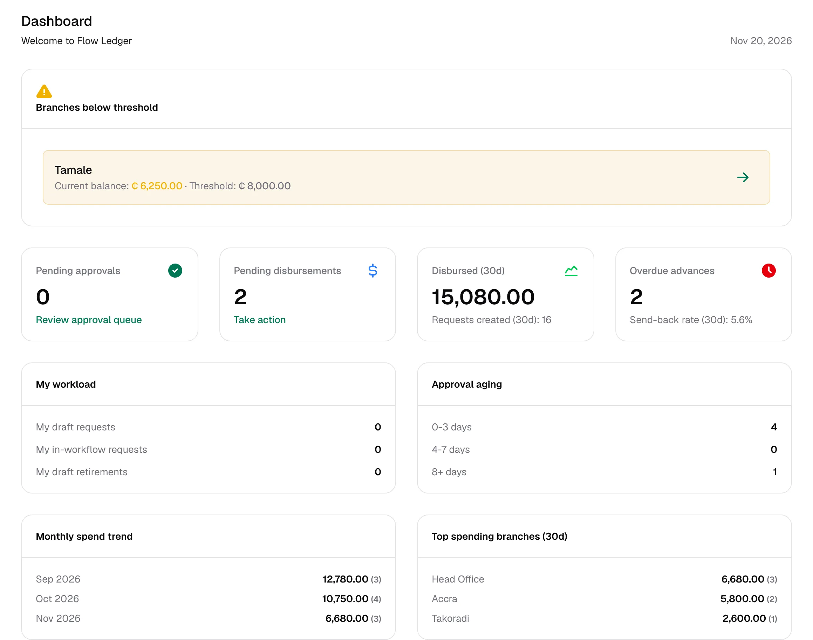

## Signing in {#signing-in}

Open your organization's Flow Ledger sign-in page and enter your **Email** and **Password**, then click **Sign in**. Check **Remember me** to stay signed in on that device.

If your organization uses a corporate identity provider, click **Sign in with SSO** instead. The first time you sign in this way, Flow Ledger automatically creates your account for you — there's nothing to set up in advance.

> Forgotten your password? Use the **Forgot Password?** link. If your organization manages identity through its SSO provider, you'll instead see *"Your password is managed by your identity provider. Please sign in and update it there."* — reset it with your organization's usual account tools, not here.

If you see a **Change Password** screen after signing in, it's because an administrator has flagged your account to set a new password before continuing — this can't be skipped.

## Keeping your account safe {#account-security}

- **Passwords** must be at least 12 characters, with upper- and lower-case letters, a number and a symbol. The password form ticks off each rule as you type, and a password known from public data breaches is refused.
- **Failed sign-ins.** After 10 failed attempts, the account is locked for 15 minutes and you'll see *"Too many failed sign-in attempts. Try again in … minute(s)."* The account owner is emailed when this happens. Resetting your password with **Forgot Password?** lifts the lock.
- **Signing out when idle.** If you're inactive for a while, Flow Ledger warns you with *"Your session is about to expire"* and a countdown. Click **Stay signed in** to carry on, or **Sign out now**. If you don't respond, you're signed out and any unsaved changes on the page are lost.

## How your organization is set up {#your-organization}

There's no setup wizard to walk through — when your organization's Flow Ledger workspace is created, it's ready to use immediately with a default **Head Office** branch and an administrator account. From there, an administrator builds out the real structure:

- [Branches, levels, departments, positions, and staff](/docs/branches/) — your organization's structure.
- [Roles](/docs/roles-permissions/) — who can do what.
- [Cost codes and currencies](/docs/cost-codes-currencies/) — reference data used across requests.
- [Approval workflows](/docs/approval-workflows/) — how requests get reviewed and approved.

If you've just been added as a user, most of this will already be in place — you can skip ahead to whichever chapter matches what you need to do.

## Finding your way around {#navigating}

The sidebar is grouped by what you're doing:

- **Requests** — Payment Requests, Retirements.
- **Finance** — Disbursements, Cashbook, and Approvals (your inbox of requests waiting on your review).
- **Reports** — every report available to you.
- **Organisation** — Levels, Branches, Departments, Cost Codes, Positions, Staff.
- **Settings** — Users, Roles, Currencies, Cash Balance Alerts, Settings, Workflows, Activity Log.

What you actually see depends on the permissions your role has been given — see [Roles & Permissions](/docs/roles-permissions/) if a section you expect is missing.

## The dashboard {#dashboard}

The dashboard is where you land after signing in. Across the top, it counts what needs attention for the branches you can see:

- **Pending approvals** — requests waiting on a stage. Click **Review approval queue** to open your [Approvals](/docs/approval-workflows/#approving-a-request).
- **Pending disbursements** — approved requests still waiting to be paid out.
- **Disbursed (30d)** — how much was paid out in the last 30 days.
- **Overdue advances** — disbursed advances that are past their retirement grace period.

Below them, **My workload** lists your own draft requests, requests still in the workflow, and draft retirements. **Approval aging** shows how long requests have been waiting for a decision, **Monthly spend trend** shows what was disbursed month by month, and **Top spending branches (30d)** ranks branches by recent spend.

If you have access to Settings, a **Branches below threshold** panel also flags any branch whose cash balance has dropped below its configured alert level (see [Cash Balance Alerts](/docs/cash-management/#cash-balance-alerts)).

Next, get familiar with how your organization is structured in [Branches, Departments & Staff](/docs/branches/).
