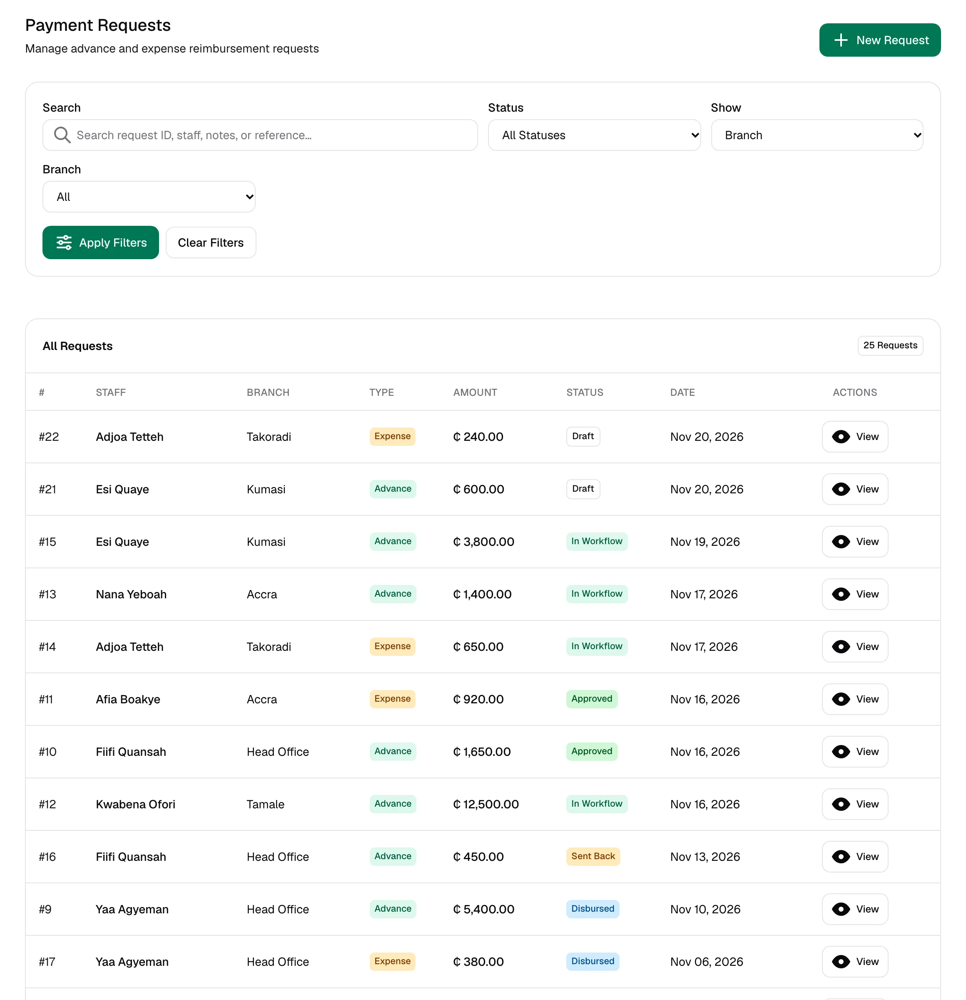
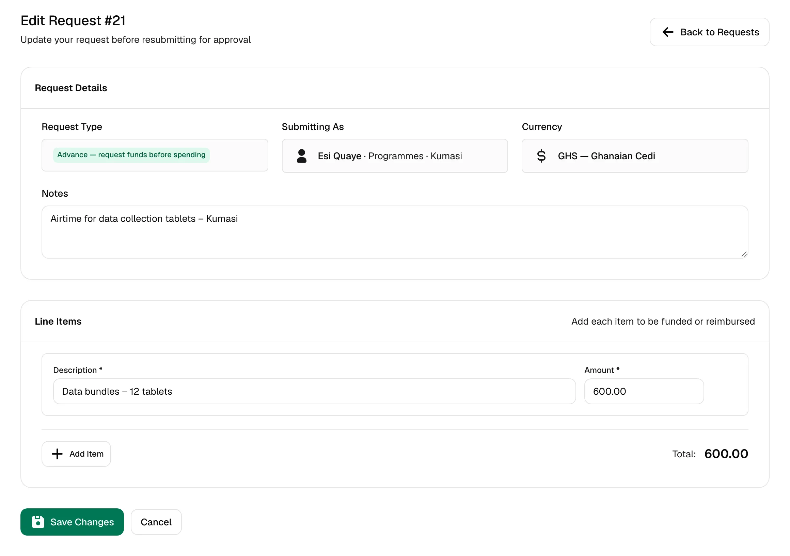
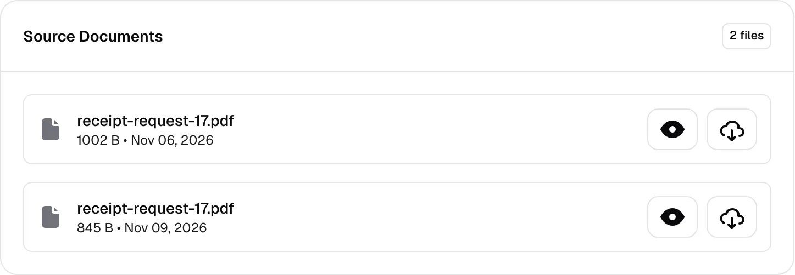
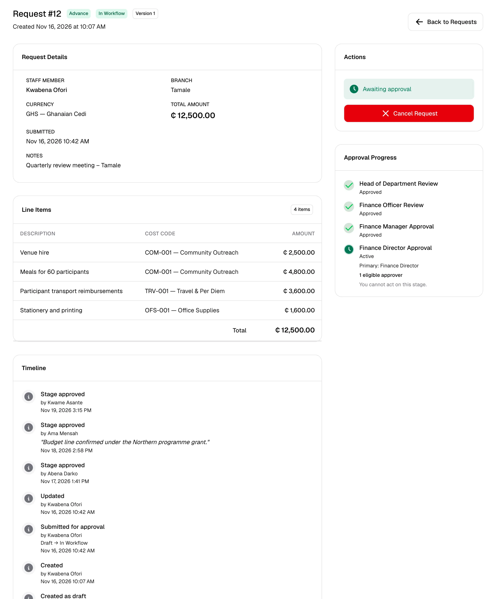
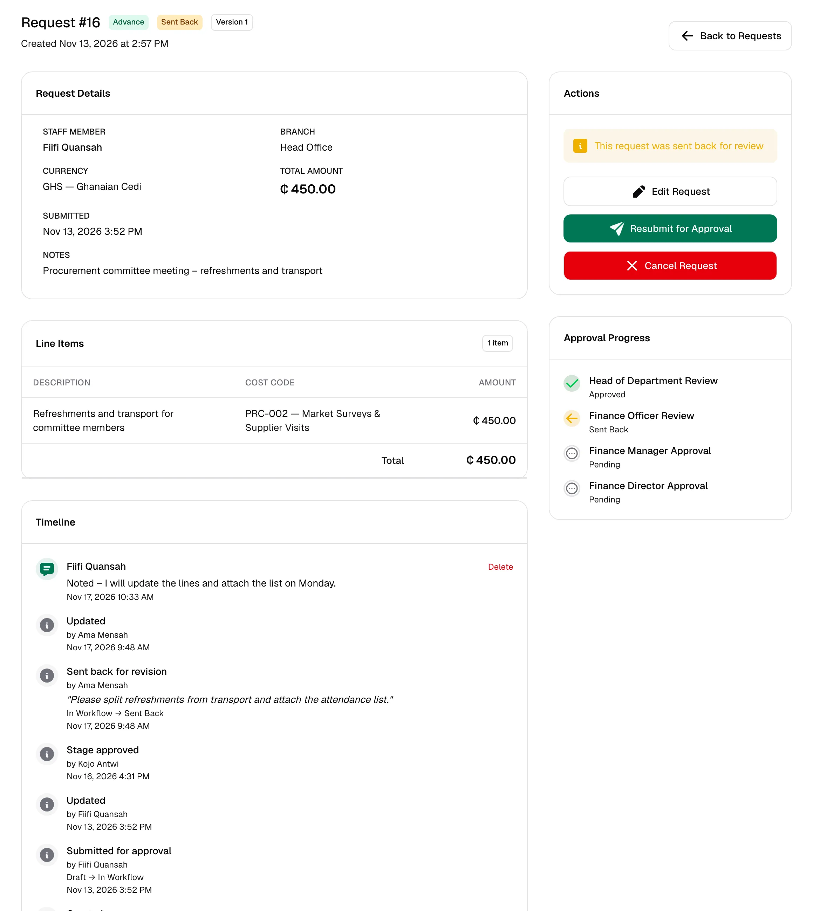
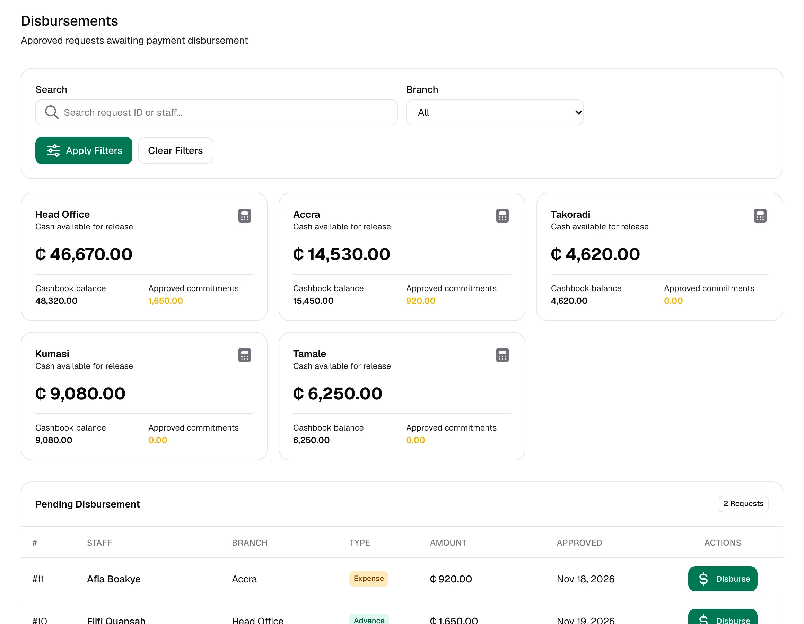
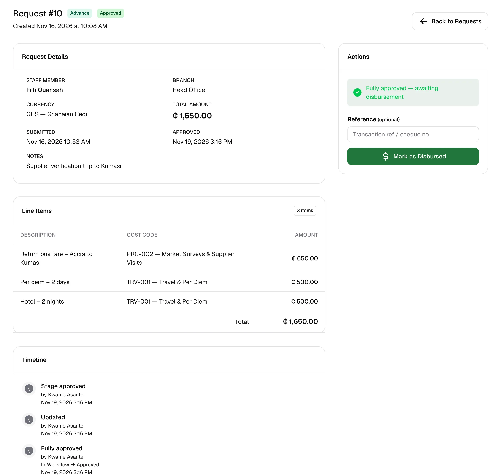

## Advances vs. Expenses {#request-types}

A **Payment Request** is how you ask for money in Flow Ledger. Every request is one of two types, chosen when you create it:

- **Advance** — "request funds before spending". Use this when you need cash up front. A disbursed Advance must later be accounted for with a [Retirement Request](/docs/retirement-requests/) — see that chapter.
- **Expense** — "reimburse money already spent". Use this when you've already paid for something out of pocket and want it repaid. Expenses don't need to be retired — the money was already spent.

> **Disbursement isn't a separate record.** There's no standalone "Disbursement" entity to manage — disbursing is simply the payout step on an approved Payment Request. Its full history lives on the request's own Timeline.

## Creating a request {#creating-a-request}

Go to **Payment Requests** and click **New Request**. Fill in the **Request Details** card:

- **Request Type** — Advance or Expense.
- **Currency** — the currency this request is in.
- **Notes** — optional context for approvers.
- **Line Items** — click **Add Item** for each thing being funded or reimbursed. Every item needs a **Description** and **Amount**. For an **Expense** item you must also pick a **Cost Code** and may add a **Receipt Number**; for an **Advance** item the cost code is optional (Flow Ledger falls back to a default advance cost code if you leave it blank).

The running **Total** updates as you add items. Click **Save as Draft** to keep working on it later, without sending it for approval yet.

## Submitting for approval {#submitting}

From a draft request, click **Submit for Approval**. Flow Ledger looks up the [approval workflow](/docs/approval-workflows/) configured for this request type and your branch (or the organization-wide default) and starts routing your request through its stages.

If your organization requires receipts for Expenses, you'll need to attach at least one **Source Document** before you can submit — you'll see *"Source documents are required. Please upload at least one before submitting."* if you try to skip this.

Under **Source Documents**, select the eye button beside a file to preview it without leaving the request. Flow Ledger can preview PDF, JPG/JPEG, PNG, WebP, DOCX, XLS, and XLSX files. Files without a preview action, including older `.doc` documents, can still be opened using the download button.

A preview is intended for quick review and may not reproduce every embedded image, formula, or formatting detail. Download the original file when you need to check its exact contents or when a file cannot be previewed.

If nobody has configured an approval workflow for this request type yet, submission is blocked with a message asking you to contact an administrator — see [Configuring workflow templates](/docs/approval-workflows/#configuring-workflow-templates).

Once submitted, the request moves to **In Workflow** and you can watch its progress in the **Approval Progress** stepper and **Timeline** on the request's page.

## Editing and resubmitting {#editing-and-resubmitting}

You can only edit a request while it's a **Draft** or has been **Sent Back** to you for revision — and only you, as the owner, can edit it. Update the details and either save the draft again or click **Resubmit for Approval**.

A resubmitted request re-enters the workflow at the exact stage that sent it back — it doesn't start over from the beginning.

## Disbursing an approved request {#disbursing}

Once a request clears every approval stage, its status becomes **Approved** and it appears in **Disbursements** — a queue of every approved request still awaiting payout, oldest first. This screen doesn't hold separate records of its own; it's simply a filtered view of Payment Requests.

Each branch card shows the **Cash available for release**: the cashbook balance less the approved requests already waiting on it. A user with permission to disburse requests clicks **Disburse** on a queue row (or opens the approved request), adds an optional **Reference** (transaction ref or cheque number), and clicks **Mark as Disbursed**. The payout is recorded as a cash payment from the branch cashbook.

For independent handling, you can't disburse a request you submitted or approved. Those requests are left out of your **Disbursements** queue. If you open one directly, Flow Ledger shows *"You cannot disburse a request you submitted or approved."* and doesn't offer the disbursement form. Another user with disbursement permission who didn't participate in the workflow must complete the payout.

Disbursing records a payout entry against the branch's [Cashbook](/docs/cash-management/#cashbook) and moves the request to **Disbursed**. If the cashbook doesn't have enough balance to cover it, you'll see *"Insufficient cashbook balance to process this disbursement."* and nothing is recorded — top up the cashbook with a manual receipt first.

Disbursed **Advances** then wait to be accounted for — see [Retirement Requests](/docs/retirement-requests/). Disbursed **Expenses** need no further action.

## Cancelling and declining {#cancelling-declining}

As the owner, you can click **Cancel Request** at any point before it's disbursed (Draft, In Workflow, Approved, or Sent Back) — this is permanent and can't be undone.

An approver can instead **Reject** a request from their [Approvals inbox](/docs/approval-workflows/#approving-a-request), which cancels the entire remaining workflow and marks the request **Denied** — this is also terminal, with no way to bring it back. If an approver instead clicks **Send Back**, the request returns to you to fix and resubmit — see [Send Back vs. Reject](/docs/approval-workflows/#send-back-vs-reject) for the difference.

Next, see how disbursed advances get accounted for in [Retirement Requests](/docs/retirement-requests/).
