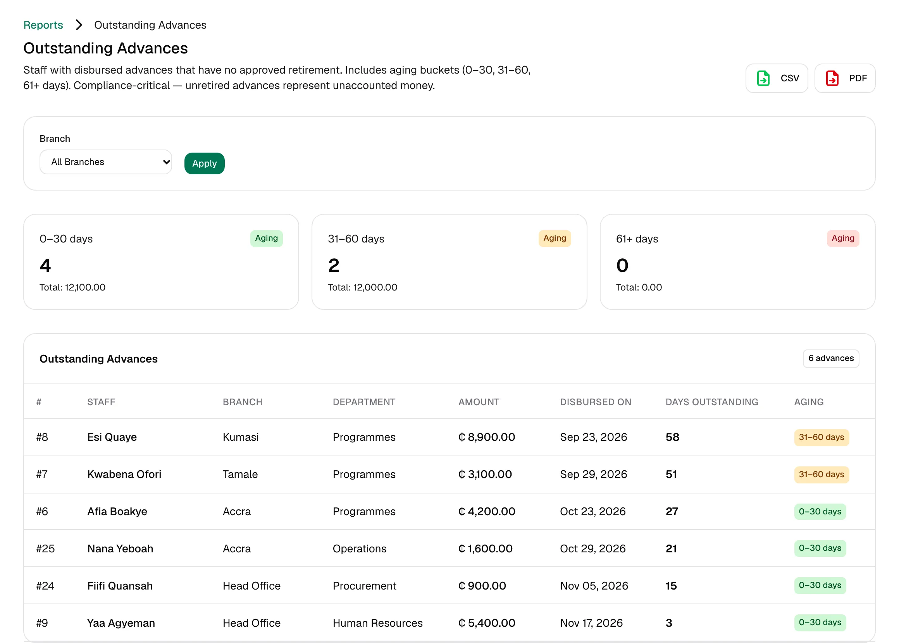
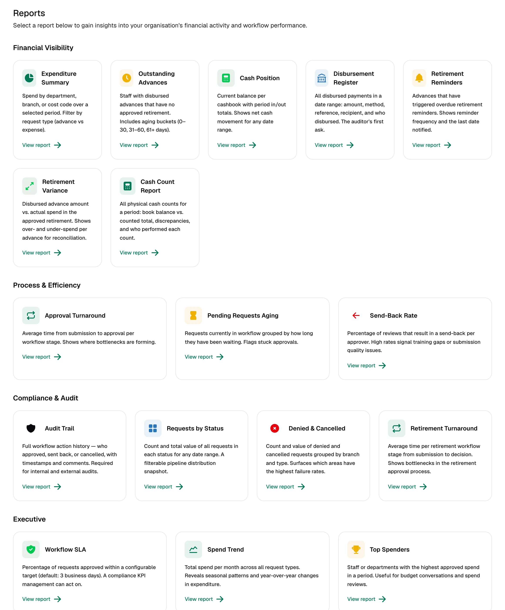
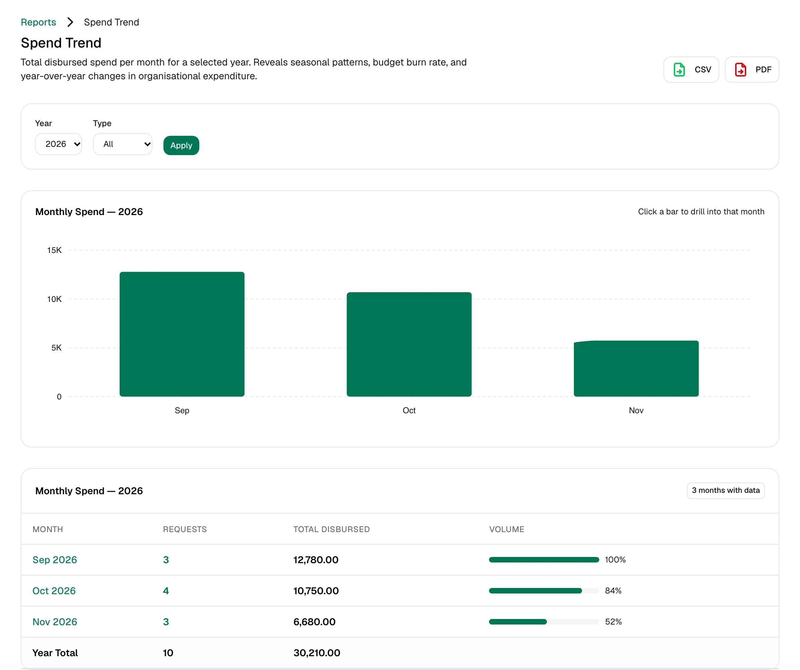
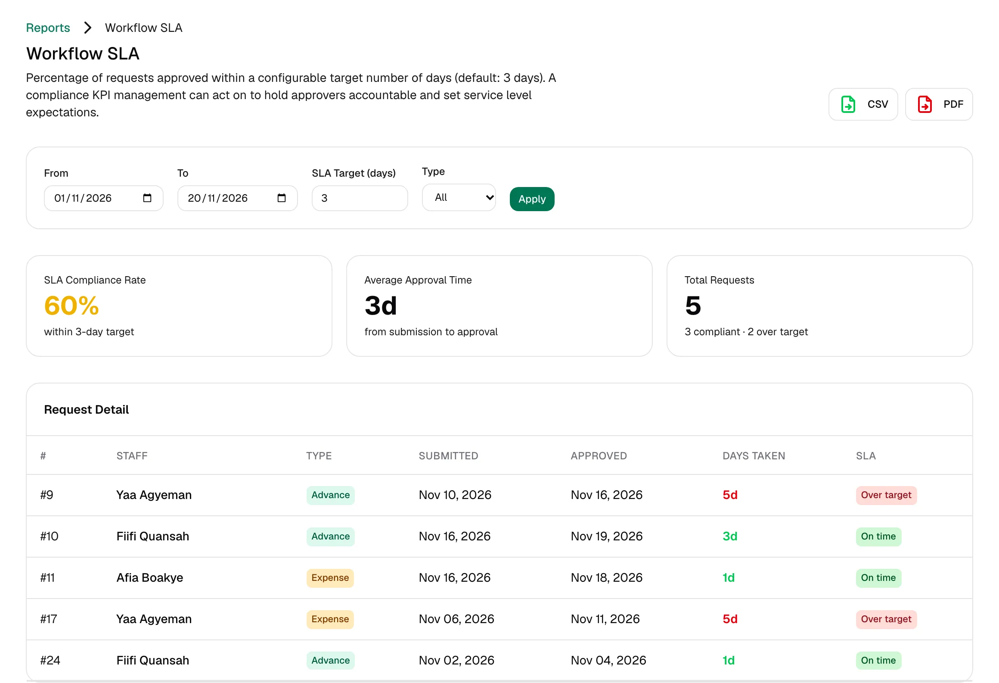

## Financial Visibility {#financial-visibility}

Reports for tracking money as it moves through the organization:

- **Expenditure Summary** — spend totals, typically by cost code or branch.
- **Outstanding Advances** — disbursed advances not yet retired.
- **Cash Position** — current cashbook balances across branches.
- **Disbursement Register** — every payout made, with method and reference.
- **Retirement Reminders** — advances currently being nagged for retirement — see [Retirement reminders](/docs/retirement-requests/#reminders).
- **Retirement Variance** — the pay-to-staff / refund-to-company differences from settled retirements.
- **Cash Count Report** — every cash count performed, with its balanced/surplus/deficit status.

## Process & Efficiency {#process-and-efficiency}

- **Approval Turnaround** — how long requests take to move through approval.
- **Pending Requests Aging** — how long requests have been sitting, unresolved.
- **Send-Back Rate** — how often requests get sent back for revision instead of approved outright.

## Compliance & Audit {#compliance-and-audit}

- **Audit Trail** — a reporting view over the same events captured in the [Activity Log](/docs/settings/#activity-log).
- **Requests by Status** — counts and lists of requests broken down by their current status.
- **Denied & Cancelled** — requests that never made it through, for reviewing why.
- **Retirement Turnaround** — how long retirements take from creation to settlement.

## Executive {#executive}

- **Workflow SLA** — approval performance against a configurable target (defaults to 3 days).
- **Spend Trend** — spend over time, shown as a chart.
- **Top Spenders** — highest spend by staff member or branch.

From several reports above, drilling into a row or count opens a **Payment Requests Breakdown** — the underlying list of individual requests behind that number.

## Filtering and exporting {#exporting}

Every report has its own filters — typically a date range and branch, and sometimes a type or group-by option. Once you've narrowed a report to what you need, use the **CSV** or **PDF** button to export it. What you see is limited to the branches you have access to — see [Branch-scoped visibility](/docs/roles-permissions/#branch-visibility) — except for Approval Turnaround, Send-Back Rate, Audit Trail, and Retirement Turnaround, which always report across the whole organization.

Next, see the organization-wide settings that shape how requests and reminders behave in [Settings](/docs/settings/).
