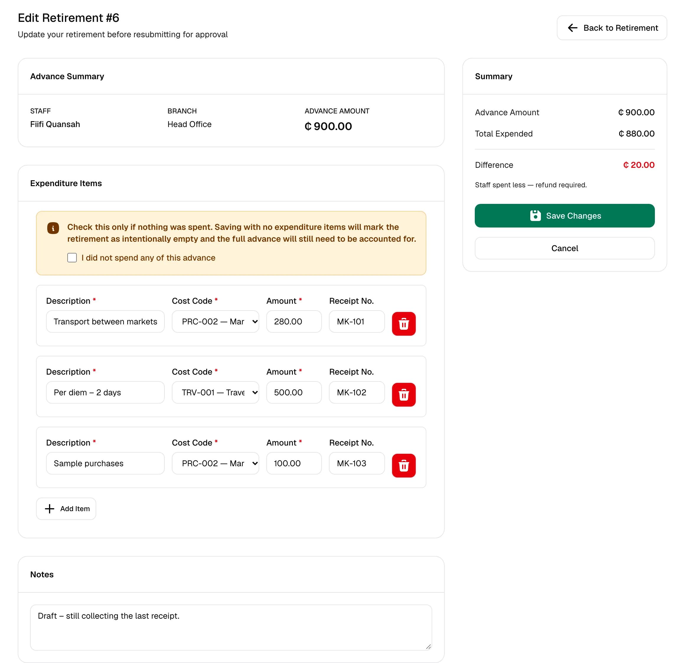
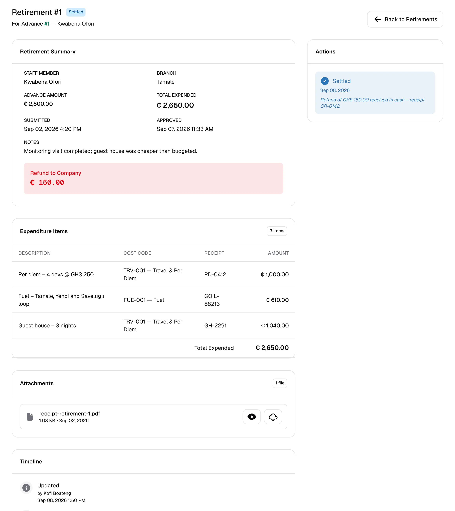
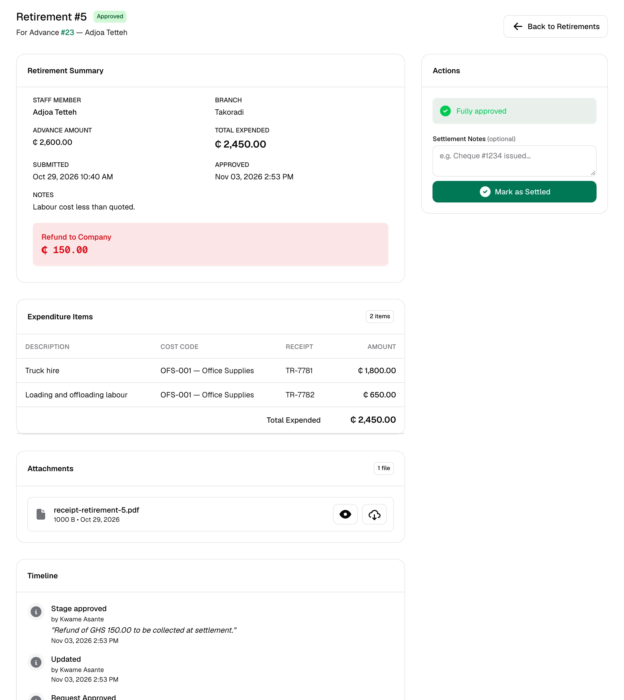

## What "retiring" an advance means {#what-is-retiring}

When an **Advance** from [Payment Requests](/docs/payment-requests/) is disbursed, that money is now the staff member's responsibility to account for. **Retiring** the advance means filing a **Retirement Request** against it: listing what was actually bought, with receipts, so Flow Ledger can work out the **difference** between the advance and what was really spent.

A retirement always belongs to exactly one disbursed Advance — you can't retire an Expense (nothing to retire; the money was already spent) and you can't retire an advance twice.

## Creating a retirement {#creating-a-retirement}

From the disbursed advance's page, click **Retire this Advance**. You'll see the **Advance Summary** with the original **Advance Amount**, and an **Expenditure Items** section where you add what was actually spent — each item needs a **Description**, **Cost Code**, and amount, with an optional **Receipt No.** and **Notes**.

As you add items, Flow Ledger shows the **Total Expended** and the **Difference** against the advance:

- **No Difference** — "No difference — fully retired."
- **Pay to Staff** — "Staff spent more — company owes the difference."
- **Refund to Company** — "Staff spent less — refund required."

Save as a draft, or submit straight away. If your organization requires receipts for retirements, attach at least one source document before submitting.

Under **Attachments**, select the eye button beside a file to preview it without leaving the retirement request. Flow Ledger can preview PDF, JPG/JPEG, PNG, WebP, DOCX, XLS, and XLSX files. Files without a preview action, including older `.doc` documents, can still be opened using the download button.

A preview is intended for quick review and may not reproduce every embedded image, formula, or formatting detail. Download the original file when you need to check its exact contents or when a file cannot be previewed.

## If nothing was spent {#no-money-spent}

If none of the advance was actually used, check **"I did not spend any of this advance"** instead of adding items. Flow Ledger warns: *"Check this only if nothing was spent. Saving with no expenditure items will mark the retirement as intentionally empty and the full advance will still need to be accounted for."* The full advance amount becomes the difference owed back to the company.

## Approval and settlement {#approval-and-settlement}

Submitting a retirement routes it through its own [approval workflow](/docs/approval-workflows/), just like a Payment Request — approvers can approve, send it back for revision, and it can be edited and resubmitted at the stage that sent it back.

Once fully approved, anyone with permission clicks **Mark as Settled**, optionally adding **Settlement Notes**. Settling:

- Marks the retirement **Settled** and flips the original Payment Request to **Retired**.
- Posts the difference to the branch [Cashbook](/docs/cash-management/#cashbook) — a payout if the company owes the staff member, or a receipt if the staff member owes a refund. If it's settled with no difference, nothing is posted.

If the cashbook doesn't have enough balance to cover a "pay to staff" settlement, you'll see *"Insufficient cashbook balance to settle this retirement."* and need to top up the cashbook first.

## Retirement reminders {#reminders}

Flow Ledger keeps track of advances that were disbursed but never retired. Once an advance has been outstanding past your organization's grace period, it starts nagging — the submitter, approvers, and/or specific roles (whoever your organization has configured to receive them) get repeated reminder notifications until the advance is retired.

Next, see how approval workflows are configured and used in [Approval Workflows](/docs/approval-workflows/).
