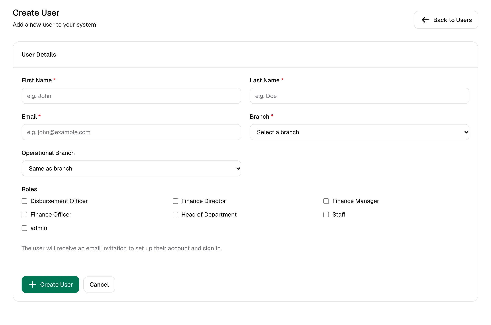
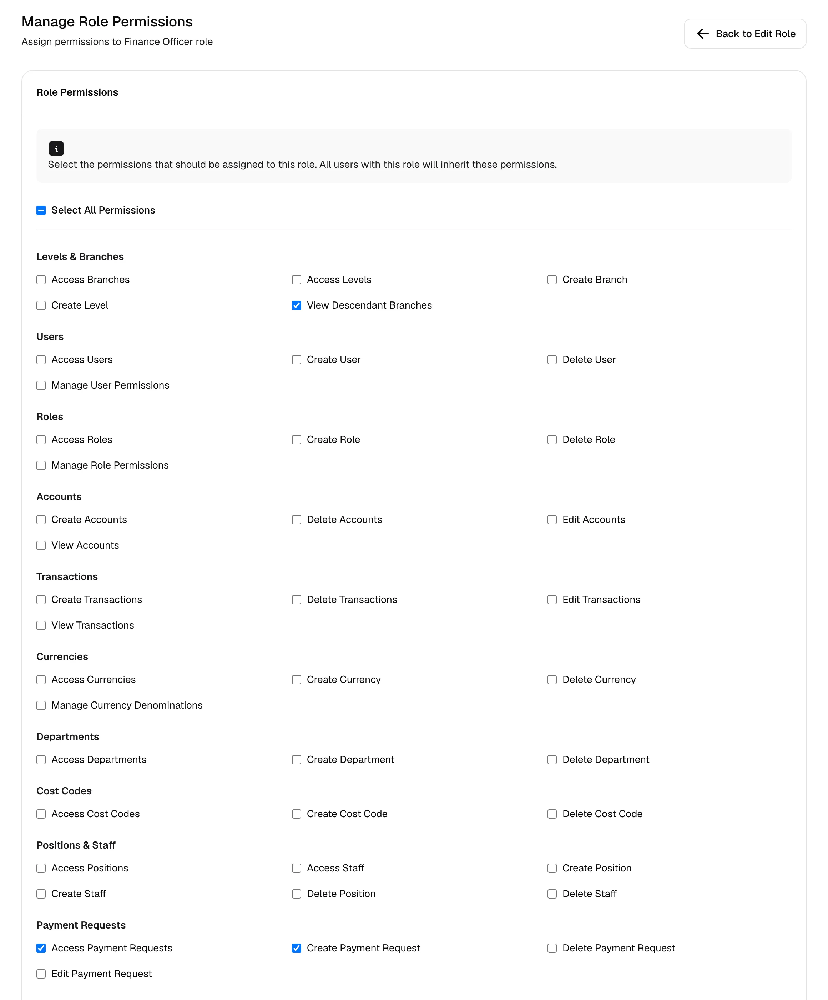
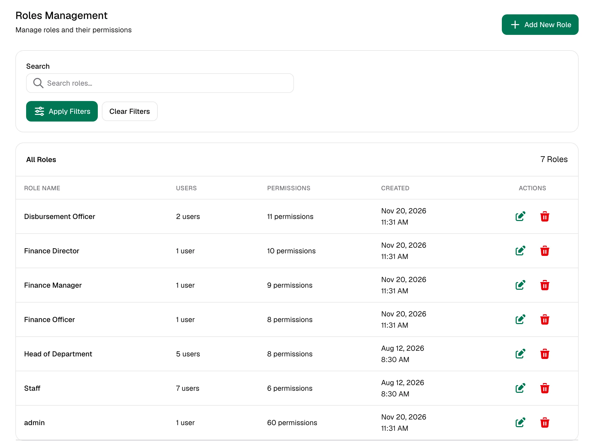

## How permissions work {#how-permissions-work}

Every capability in Flow Ledger — viewing, creating, deleting, approving, disbursing, and so on, across every module — is backed by an individual **permission**. A **Role** is simply a named bundle of permissions; users get access by being assigned one or more roles under **Settings → Users**, or by being granted a permission directly.

A brand-new organization starts with a single **admin** role holding every permission, assigned to the first account. From there, it's up to your organization's administrators to create narrower roles — for example an "Approver" role that can only review and approve requests.

## Creating roles and assigning users {#creating-roles}

Under **Settings → Roles**, click to create a new role, give it a name, and tick the permissions it should carry from the full checkbox list — or use **Select All Permissions** for a broad role. Under **Settings → Users**, assign one or more roles to each user, or grant individual permissions directly if a single extra capability is all they need.

A role can't be deleted while any user still holds it — reassign or remove those users first.

## The permission escalation guard {#escalation-guard}

> You can never grant a role, or a user directly, a permission that you don't hold yourself. This stops anyone from accidentally (or deliberately) creating a role more powerful than their own account.

In practice this means: if you're editing a role and try to check a permission box you don't personally have, saving will fail. If your organization ends up needing a permission granted that nobody currently holds, that's a support situation — see [Contact support](/docs/troubleshooting/#support).

## Branch-scoped visibility {#branch-visibility}

By default, a user only sees data — requests, cashbooks, reports — for their own branch. A separate permission extends this to a branch plus every branch beneath it in the [branch tree](/docs/branches/#branches). This is why two people with what looks like "the same" role can still see different amounts of data, if their branch assignments differ.

Next, see the full list of reports available and how they respect this same branch scoping in [Reports](/docs/reports/).
