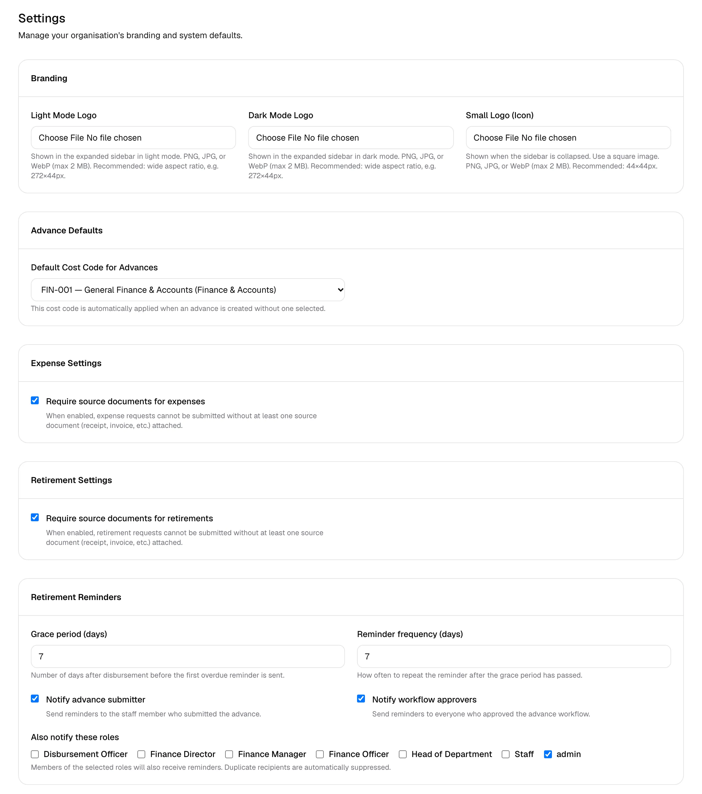
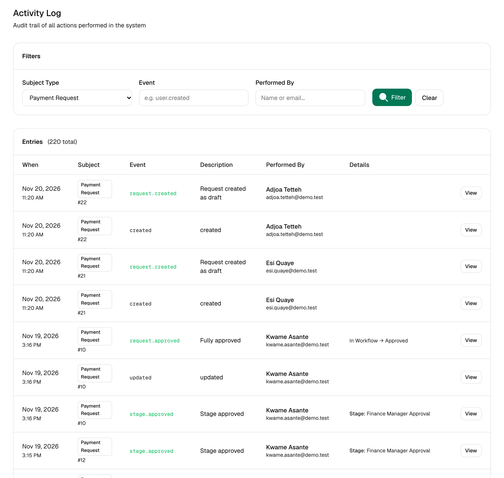

## Branding {#branding}

Under **Settings → Settings**, upload your organization's **Light Mode Logo**, **Dark Mode Logo**, and **Small Logo (Icon)** (PNG, JPG, or WebP, up to 2MB each). These appear throughout the app and adapt to whichever theme a user has selected.

## Advance and expense defaults {#request-defaults}

Set a **Default Cost Code for Advances** so advance line items don't require one to be picked manually every time — see [Cost codes](/docs/cost-codes-currencies/#cost-codes). Toggle **Require source documents for expenses** and **Require source documents for retirements** to control whether a receipt attachment is mandatory before those requests can be submitted.

## Retirement reminders {#retirement-reminders}

Configure how persistent Flow Ledger is about unretired advances — see [Retirement reminders](/docs/retirement-requests/#reminders). Set the **Grace period (days)** before reminders start and the **Reminder frequency (days)** between repeat notices, then choose who receives them: **Notify advance submitter**, **Notify workflow approvers**, and/or specific roles under **Also notify these roles**.

## Single sign-on {#sso-settings}

If your organization signs in through an identity provider, set the **Default Branch for SSO-Provisioned Users** — new accounts created automatically on first SSO sign-in are assigned here — and the **Staff Role Name**, the role name from your identity provider that Flow Ledger matches against to automatically link a new SSO user to an existing staff record.

## Activity log {#activity-log}

Under **Settings → Activity Log**, every meaningful action across the system — requests created, approved, sent back, or disbursed; cashbook entries; cash counts; changes to users, roles, branches, currencies, and settings — is recorded as an audit trail entry. Filter by **Subject Type**, **Event**, or **Performed By**, and open any entry to see exactly what changed. Entries cannot be edited or deleted from within Flow Ledger, and they are kept for seven years.

That's the full guide. If something isn't behaving as expected, check [Troubleshooting](/docs/troubleshooting/) next.
